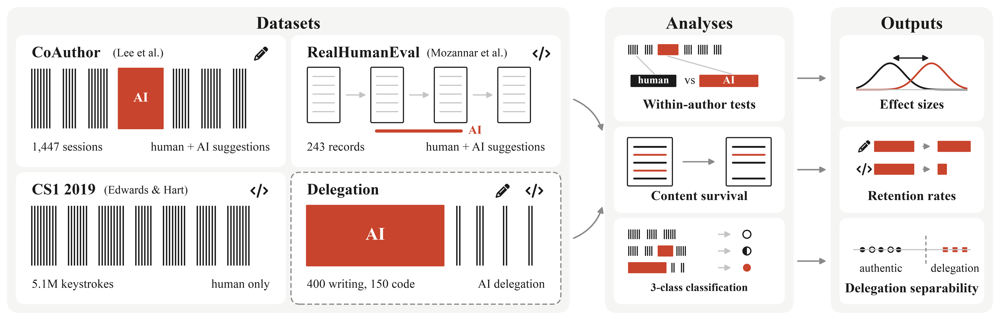

# Does AI Assistance Leave a Temporal Fingerprint? Detecting Overreliance in AI-Assisted Writing and Programming

Created by <a href="https://edavalosanaya.github.io" target="_blank">Eduardo Davalos</a> and <a href="https://scholar.google.com/citations?user=_E0SGAkAAAAJ&hl=en" target="_blank">Yike Zhang</a> from <a href="https://ailuruslab.github.io" target="_blank">Trinity University</a> and <a href="https://knotlab.github.io/KnotLab/" target="_blank">St. Mary's University</a>

### [Paper](https://arxiv.org/abs/2609.17883) | [Video](https://youtu.be/ewHm234OpqY)

<p></p>

[](https://arxiv.org/abs/2609.17883) [](https://youtu.be/ewHm234OpqY) [](#reference) [](pyproject.toml) [](#license)

Generative AI has made the finished essay or program unreliable evidence of student learning, and AI detectors that judge only the final product are inaccurate and ethically contentious. This repository contains the analysis code for our [AHFE 2026 paper](https://arxiv.org/abs/2609.17883), which asks whether AI assistance leaves a **temporal signature in how work is produced**, whether that signature **generalizes from writing to programming**, and whether it separates **ordinary collaboration from wholesale delegation**. Every feature is computed from timing alone, with no text content and no AI labels.

<p align="center">
  
</p>

# Key Findings

| | Writing (CoAuthor) | Programming (RealHumanEval) |
|---|---|---|
| **AI arrives in chunks:** AI vs. the author's own typing | 68 vs. 36 characters (d<sub>z</sub> = 1.13) | 188 vs. 51 characters (d<sub>z</sub> = 3.54) |
| **The afterlife of AI content:** share kept intact | 93% of AI characters | 14% of accepted autocomplete spans |
| **Delegation is detectable:** F1, simulated delegation | 0.998 | 0.997 |
| **Real work is not flagged:** misclassified as delegation | 1 of 1,447 sessions (0.07%) | 1 of 219 traces (0.46%) |

Ordinary collaboration remains hard to tell apart from minimal-AI work, which is the desirable outcome: permitted AI use should not be flagged. Temporal evidence flags **delegation, not assistance**. The delegation condition is simulated, so these results establish sensitivity, not field accuracy.

# Getting Started

The analysis uses [uv](https://docs.astral.sh/uv/) and Python 3.12+.

```bash
git clone https://github.com/AilurusLab/AITemporalFingerprint_AHFE2026.git
cd AITemporalFingerprint_AHFE2026
uv sync
```

### Data

All three corpora are public. Download them into `data/` with this layout (the folder is git-ignored):

```text
data/
├── coauthor/coauthor-v1.0/*.jsonl      # 1,447 sessions
├── realhumaneval/                       # autocomplete_data.csv, chat_data.csv, study_data.csv, tasks_data.csv
└── cs1_2019_keystrokes.csv              # 2019 CS1 keystroke data
```

| Dataset | Source | License | Role |
|---|---|---|---|
| CoAuthor (Lee et al., 2022) | [coauthor.stanford.edu](https://coauthor.stanford.edu) | see source | Keystroke-level co-writing with GPT-3 |
| RealHumanEval (Mozannar et al., 2025) | [Hugging Face: hsseinmz/realhumaneval](https://huggingface.co/datasets/hsseinmz/realhumaneval) | CC0 | Programming with autocomplete and chat |
| 2019 CS1 Keystroke Data (Edwards et al., 2023) | [Harvard Dataverse: 10.7910/DVN/6BPCXN](https://doi.org/10.7910/DVN/6BPCXN) | CC BY | Pre-LLM, human-only baseline |

### Reproducing the Paper

Run the scripts from the repository root with `uv run python scripts/<name>.py`. Results are deterministic (fixed seeds).

| Step | Script | Produces |
|---|---|---|
| 1 | `coauthor_features.py` | `results/coauthor_sessions.csv` |
| 2 | `realhumaneval_features.py` | `results/realhumaneval_participants.csv`, `results/realhumaneval_survival.csv` |
| 3 | `cs1_baseline.py` | `results/cs1_baseline.csv` |
| 4 | `spectrum_writing.py`, `spectrum_code.py` | `results/writing_spectrum.csv`, `results/code_spectrum.csv` |
| 5 | `coauthor_analysis.py`, `realhumaneval_analysis.py` | Paired within-author tests and content survival |
| 6 | `robustness.py`, `sensitivity_strict.py`, `review_response.py` | Pause-threshold sensitivity, ablations, zero-AI subset, confusion matrices, evasion check |
| 7 | `methods_overview.py`, `paper_figures.py`, `qualitative_timelines.py` | Figures 1–4 in `results/` |

# Repository Structure

```text
├── results/         # Derived feature tables and paper figures
├── scripts/         # Feature extraction, analyses, and figures
└── pyproject.toml   # Python dependencies (uv)
```

# Reference

If you use this work in your research, please cite us using the following:

```bibtex
@misc{davalos2026temporal,
	title={Does AI Assistance Leave a Temporal Fingerprint? Detecting Overreliance in AI-Assisted Writing and Programming},
	author={Eduardo Davalos and Yike Zhang},
	year={2026},
	eprint={2609.17883},
	archivePrefix={arXiv},
	primaryClass={cs.HC},
	url={https://arxiv.org/abs/2609.17883}
}
```

This work builds on the Learning Visibility Framework:

```bibtex
@misc{davalos2026measurement,
	title={AI Misuse in Education is a Measurement Problem: Toward a Learning Visibility Framework},
	author={Eduardo Davalos and Yike Zhang},
	year={2026},
	eprint={2603.07834},
	archivePrefix={arXiv}
}
```

# License

The analysis code is open-sourced under the [MIT License](LICENSE). The datasets remain under their original licenses (see [Data](#data)).
